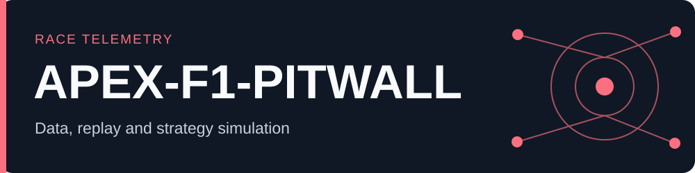

# APEX F1 Pit Wall

<!-- portfolio-summary:start -->



> **F1 telemetry and strategy dashboard** | **Status:** Beta; simulations are estimates and live data may require access.
>
> [Live application](https://apex-f1-pitwall.vercel.app) · [Architecture](README.md#deployment) · [Demo / verification](README.md#features) · [Source code](https://github.com/yassineaqejjaj/apex-f1-pitwall)

<!-- portfolio-summary:end -->


Independent race engineering dashboard in French, using real [OpenF1](https://openf1.org/docs/) data. Not affiliated with Formula 1, FIA or a racing team.

## Features

- Isometric GPS driver tracker with synchronized positions, circular speed/throttle/brake instruments and a sample animation cursor.
- Timing tower, favourite driver saved on the device, up to four-driver comparison.
- GPS track split into three time-derived sectors, mini-sector codes when available.
- Car telemetry, relative time cursor, tyre stints, pit stops, pace and position history.
- Real team-radio recordings linked to the upstream host, filtered by driver and replay time.
- Driver/constructor championship before the selected race or after it (explicitly separate from lap replay).
- Custom in-app alerts: gaps, tyre age, positions, pit stops, flags and radio. Rules persist in localStorage; event history stays in memory. The tab must remain open and receiving updates. No background monitoring or push notifications.
- Deterministic strategy simulation: editable pit loss, pace, degradation, fresh-tyre gain, warmup and target gap. Shows stop-window scenarios and one-lap undercut estimates.

## Run locally

Node.js 22 or 24 recommended. No npm dependencies.

```sh
npm run start
# http://localhost:4173
npm run check
npm test
npm run build
```

`public/data/silverstone.json` is a real July 6, 2025 Silverstone race snapshot. Full timing history and lap-40 car/GPS samples for seven drivers are bundled. Other tours, drivers and sessions load on demand from OpenF1. Historical data is free; live access requires an active OpenF1 subscription and a valid Bearer token. The live client refreshes every 20 seconds, not a continuous high-frequency stream.

## Deployment

### Railway

server/Dockerfile + railway.json deploy a Node server with `/health`, static fallback and `/api/openf1/:endpoint`. Only documented OpenF1 endpoints are allowed. Anonymous data is cached for 15 seconds; authenticated responses never enter shared caches. Bearer tokens are forwarded to api.openf1.org and never stored in files or logs. The proxy applies origin allowlists and per-client rate limits. No server subscription token is exposed.

Set `ALLOWED_ORIGINS` to exact comma-separated frontend origins, including the production Vercel domain and any allowed previews. `PORT` is supplied by Railway (default 8080 in the container).

### Vercel

vercel.json builds the static frontend into `dist/`. Set build environment `PUBLIC_API_BASE=https://<railway-domain>/api/openf1`. Runtime configuration contains only this public API URL. Without it, the frontend calls OpenF1 directly.

```sh
vercel --prod
railway up --service api
```

The Railway service also serves the complete dashboard at its root as a fallback. Radio audio is played directly from the source host and may be unavailable; recordings are not rehosted.

## Model limits

Strategy results are estimates, not predictions. Current pace already includes current tyre age; age is contextual. Degradation is linear and user-specified. Warmup and net pit loss are charged once. The one-lap undercut assumes the rival pits one lap later with equal pit losses. Traffic, weather, Safety Car, grip, fuel and mandatory compound rules are not simulated. The known session lap count is used for the initial historical horizon; for a live session set remaining laps yourself.

The championship “after” view contains the provider’s latest/final race state and is intentionally not recalculated at each historical lap. Track sector boundaries and GPS placement are approximate. Missing/stale timing intervals are shown as —. Some radio files and beta championship data may be unavailable.

## Security and privacy

No account credentials or OpenF1 tokens belong in Git. `.env*`, `.vercel`, `.railway`, build output and Sites metadata are ignored. User favourites and alert rules are local to the browser. A connected client token remains only in that tab’s memory. If the Railway proxy is configured, the token transits that service before OpenF1; the connection dialog explains this.
